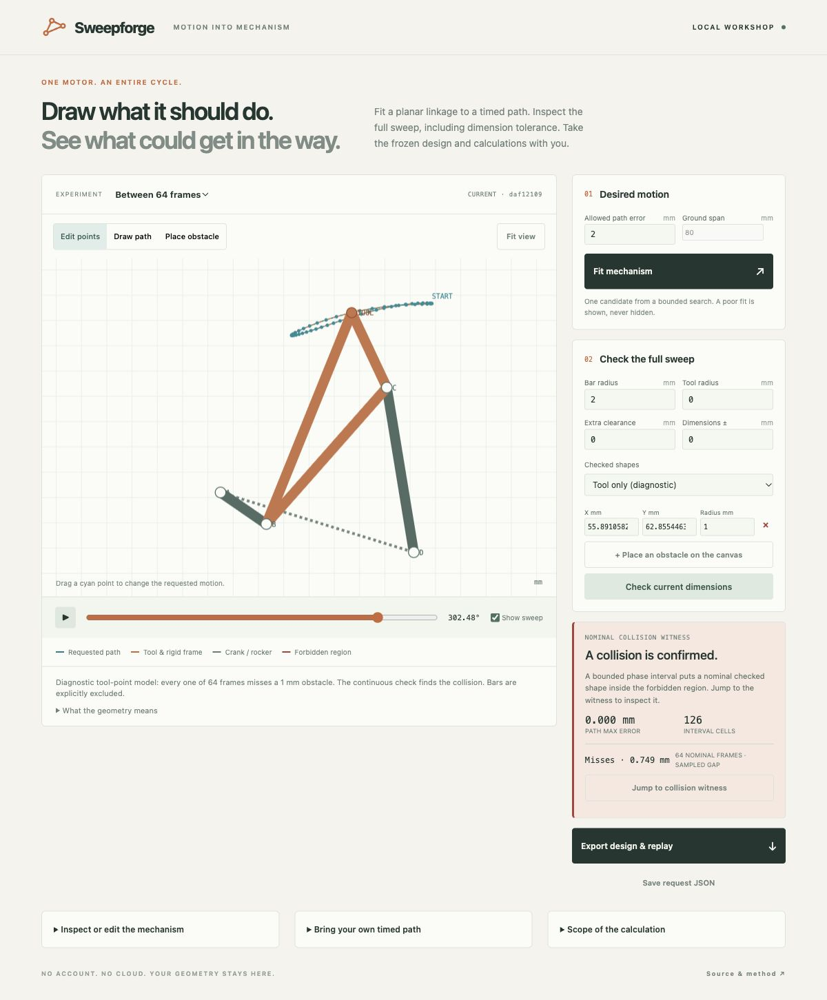

# Sweepforge

**Draw a motion. Fit a one-motor mechanism. Check what happens between the frames.**

Sweepforge is a local workshop for timed-path linkage design. Edit a loop, fit a planar crank-rocker, add circular obstacles, and inspect the sweep of its bar shapes across a whole revolution and a declared dimension tolerance. Export the frozen design, conceptual flat patterns and calculations someone else can rerun.

No account, AI provider, cloud computation or runtime network dependency. Original software and synthetic examples, MIT licensed.



## Try it

**[Open the no-install frozen demo](https://nazeeh111.github.io/Sweepforge/)** to explore a real exported mechanism and saved collision evidence. The full fitting and interval checker run in the local workshop below.

Python 3.12 or later. From this repository:

```sh
python3 -m venv .venv
source .venv/bin/activate
python -m pip install -r requirements.lock .
sweepforge studio
```

Open **http://127.0.0.1:6381/**. The released wheel can also be installed with `python -m pip install /path/to/sweepforge-0.1.0-py3-none-any.whl`. Dependency installation needs a package source or a local wheel cache; calculations use no network.

Start with **Sculpted loop**. Drag a cyan target point, then **Fit mechanism**. Add an obstacle or edit bar radius and dimension tolerance, then **Check current dimensions**. Dimension edits invalidate the previous result. Export recomputes from the frozen inputs and never accepts a client-supplied verdict.

The **Between 64 frames** example is an intentional counterexample: 64 nominal tool-point samples miss a 1 mm disk, but an interval check finds a collision between them. This diagnostic example explicitly excludes bars. The ordinary full-body mode checks six capsule-shaped bars and the tool.

## What makes the check different from playback

Animation samples a motion. Sweepforge encloses entire angle intervals, retaining all admitted dimension values, and subdivides until it can establish separation, find a nominal interior collision witness, or refuse a verdict. It never turns a budget limit or touching geometry into a clear result.

| Result | Meaning |
| --- | --- |
| `clear_under_model` | Every selected shape stays outside every expanded obstacle across the entire revolution and dimension box. |
| `collision` | A nominal phase interval has a strictly interior geometric overlap. Jump to the witness in the studio. |
| `unresolved` | Tangency, tolerance overlap, invalid enclosure or the finite budget prevented a verdict. |
| `no_obstacles` | There was no clearance question to answer. |

The report binds the exact normalized request and dimensions by SHA-256. This detects changed inputs; it is not a signature. The studio displays a separate 64-frame nominal baseline, with no continuous-clearance claim.

## Take the work with you

**Export design & replay** creates a ZIP containing:

- Frozen request, dimensions and freshly computed evidence.
- A self-contained HTML playback with a phase slider. Its report is saved evidence; playback does not run the interval checker.
- SVG and DXF nominal bar patterns in millimetres, hole-center dimensions and rigid-frame assembly coordinates. Unsupported patterns are explicitly refused.
- Actual calculation source, MIT license, exact dependency lock, file digests and `verifier.py`.

Extract the bundle, install its dependencies in an isolated environment, and run `python /path/to/bundle/verifier.py` from any directory. It checks file digests and dependency versions, then recomputes the report from the bundled inputs and source. Conceptual patterns are not a validated manufacturing plan. [Fabrication limits](docs/fabrication.md) explain how the exported shapes relate to the model.

## CLI

```sh
sweepforge solve examples/sculpted-request.json --out solution.json
sweepforge check examples/sculpted-design.json --out checked.json
sweepforge export examples/sculpted-design.json --out design.zip
```

`solve` consumes a request. `check` and `export` consume `{"request": …, "design": …}`. The CLI refuses to overwrite existing output files. The [method](docs/method.md) documents the geometry, request bounds and interpretation.

## What this version covers

One planar crank-rocker topology, a fixed 80 mm ground span and the positive circle-intersection assembly branch. Ordered target points represent equal motor-phase steps. A drawn path is resampled at equal arc length, assigning a timing. Ten deterministic fitting starts can find an approximate candidate; they do not prove the best solution, uniqueness or impossibility. Fit error is measured at the target samples.

Dimension intervals cover ground, crank/coupler/rocker lengths, tool-frame coordinates and body radii. Frame rotation, phase and translation are exact conventions. Obstacles are fixed circles. Own-link contact, joint stacks, bearings, motor housing, alignment uncertainty, loads, friction, flex and physical safety are outside the model. No hardware was tested. mpmath's interval support is experimental; the method and tests state the narrower operations used.

## Evidence and prior work

Tests include independent rigid-circle geometry, held-out inverse-fit positions, dimensional/angle interval containment, closest-point capsule enclosures, nominal collisions, tolerance-only uncertainty, budget/tangency refusals, strict input validation, export tampering and outside-folder replay. JavaScript geometry has independent closure controls. Hosted checks exercise Linux and macOS with fresh installed CLI runs.

Mechanism synthesis and continuous collision methods have substantial prior art. [MotionGen](https://docs.motiongen.io/docs/kinematic-synthesis/path-synthesis), [Pyslvs](https://github.com/KmolYuan/Pyslvs-UI) and [Disney Research](https://la.disneyresearch.com/publication/computational-design-of-mechanical-characters/) are relevant precedents. Sweepforge's contribution is this focused integration of timed fitting, interval body/tolerance clearance, visible counterexamples and portable recalculation. No claim of inventing four-bar synthesis or outperforming those systems.

Built with NumPy, SciPy and [mpmath](https://mpmath.org/doc/current/contexts.html). Development and review used Codex; reproducible calculations support the claims. See [CONTRIBUTING.md](CONTRIBUTING.md) for useful contributions and the verification commands.
